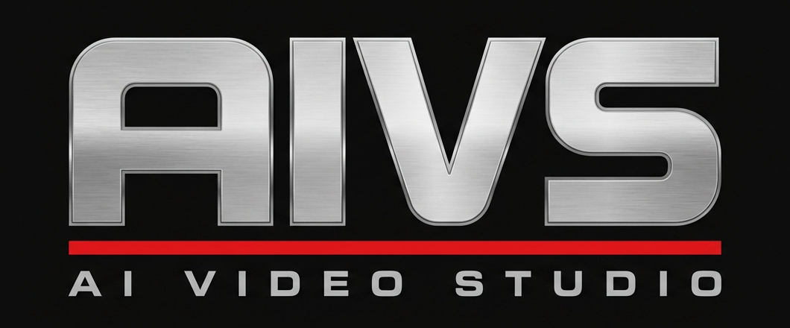
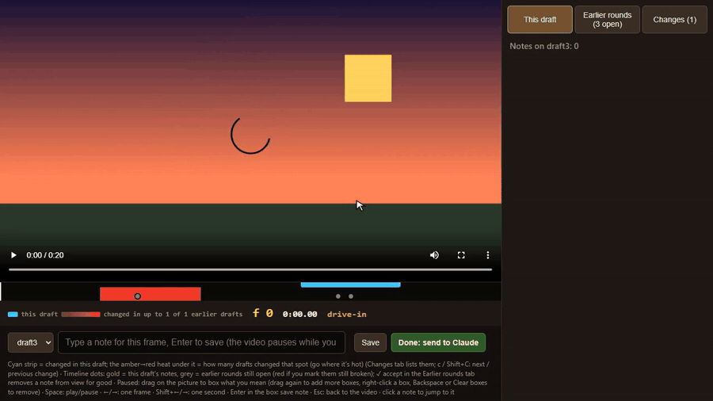
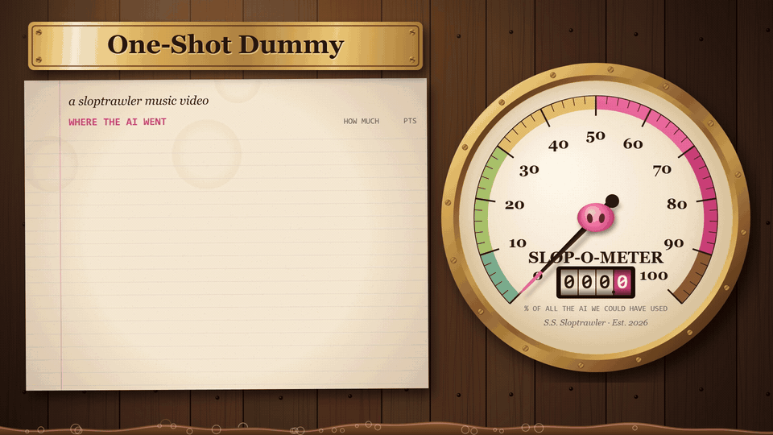
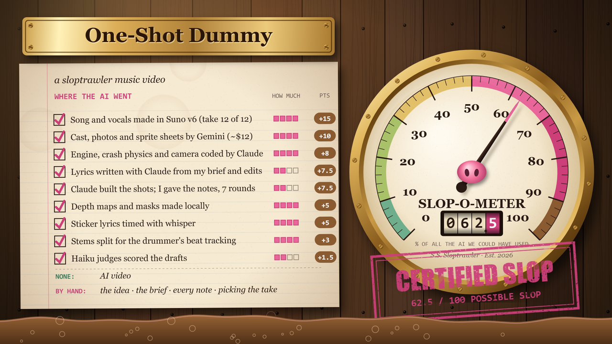
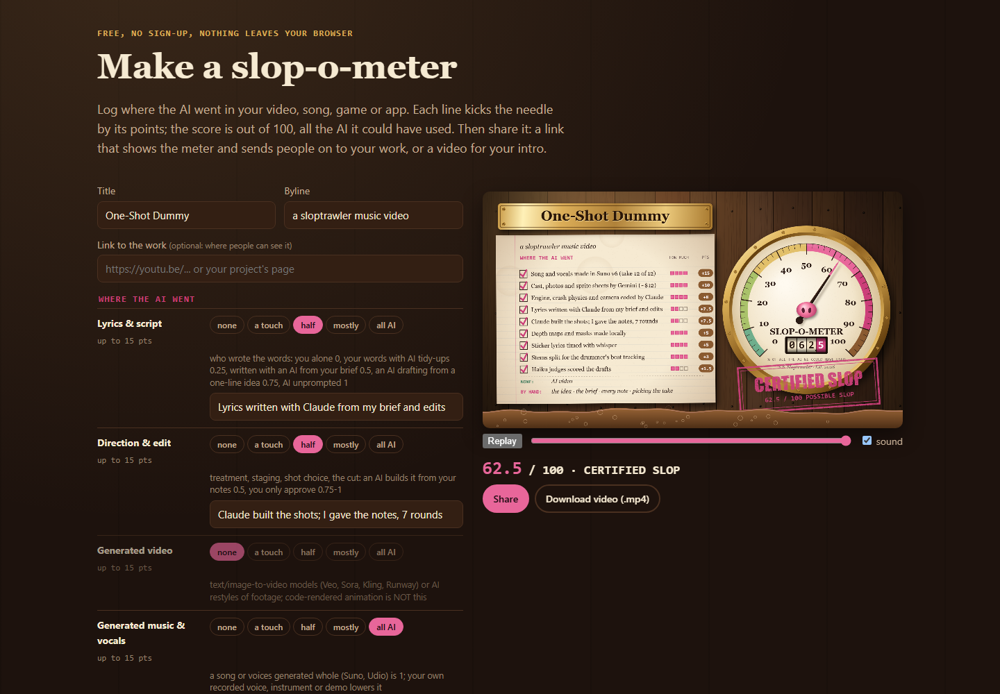

<p align="center"></p>

# AIVCR - AI Video Creation Repo

Tools for making videos with an AI agent. They keep a person in charge of every frame. Think of it as an AI VCR for
cutting the old way: watch the tape, stop on the frame, mark it up, hand back the notes. The first one is the
**review harness**, a [Claude Code](https://claude.com/claude-code) skill. You watch a draft in your browser, pause
on a frame, box what you mean and type a note. Claude reads your notes, marked-up frames included, before it touches
the next draft.

<p align="center"></p>

Two rounds in 48 seconds. On draft 1 you box the sky and ask for night. Draft 2 lands with the change lit up on the
timeline, and a wipe compares it with the frame you marked. The moon is dull, so you box it and ask for a brighter
one. Draft 3 lands, you wipe again, and both notes are closed.

## What it's for

Videos an agent builds from code and stills: motion graphics, animated stills, lyric videos, title cards, explainers.
It also works on videos with real footage in them when the agent's job is the overlays and cuts around it: captions,
callouts, blurs, cards, trims. The diff compares drafts frame by frame at the same moment, so a change to an overlay
shows up as just that stretch. A cut that moves everything after it marks the rest of the video as changed.

## The review harness

- **Frame-accurate notes.** The page shows the frame number, time, shot name and the line being sung. Every note saves
  all of it to `review/notes_<draft>.json`.
- **Point at it.** Pause and drag boxes over the picture. Right-click a box to remove it. The note keeps the boxes and a
  JPEG of the frame with them drawn on.
- **What changed since last time.** Each draft is compared with the one before it. The changed stretches show as a cyan
  strip on the timeline. Under the strip, a heatmap shows how many drafts have reworked each moment. Red means the
  work keeps coming back there.
- **Earlier rounds.** Notes from earlier drafts stay on the timeline until you mark them fixed. Mark a note "still
  broken" and Claude fixes it first.
- **Before and after.** Click an earlier note and drag across the picture to wipe between the frame you marked, boxes
  and all, and the new draft at the same moment.
- **Several videos in one project.** A main cut, a P.S. and Shorts each get a tab.
- **Local only.** One Node server on 127.0.0.1, no accounts, nothing uploaded.

## Install

You need [Claude Code](https://claude.com/claude-code), Node 18+, Python 3 with `numpy`, and `ffmpeg` on your PATH.

macOS / Linux:

```bash
git clone https://github.com/NTBooks/AIVCR.git
```

```bash
mkdir -p ~/.claude/skills && cp -r AIVCR/skills/review-harness ~/.claude/skills/
```

```bash
pip install numpy
```

Windows (PowerShell):

```powershell
git clone https://github.com/NTBooks/AIVCR.git
```

```powershell
Copy-Item -Recurse AIVCR\skills\review-harness "$HOME\.claude\skills\"
```

```powershell
pip install numpy
```

Start a new Claude Code session afterwards. The skill shows up as `review-harness`.

## Use it

**With Claude.** Ask for a review page when a draft is ready: "put draft 3 on the review page". Claude adds the draft,
starts the server and gives you the link. Leave your notes and press **Done: send to Claude**. Then say "notes are in".

**By hand.** Any folder works as a project:

```bash
python ~/.claude/skills/review-harness/scripts/add_draft.py my-video render.mp4
```

```bash
node ~/.claude/skills/review-harness/scripts/review_server.mjs 5190 my-video
```

Open http://127.0.0.1:5190/. Each `add_draft.py` call adds the next draft (`draft1`, `draft2`, ...). Name one yourself
as the third argument: `ps-draft2` puts it on a "ps" tab.

The server builds any missing diff by itself, at startup and when you open a draft, so the cyan strip and heatmap show
up even when your render pipeline never ran the diff. While it works, the Changes tab says "finding...".

Optional extras, all in the project folder:

| File | What it adds |
| --- | --- |
| `out/<draft>_shots.json` `[{name, t0, t1}]` | shot names in the HUD and on the change labels |
| `player/lines.json` `[{t0, t1, text}]` | the sung line or subtitle under the video |
| `out/pieces.json` `{"": "Main", "ps": "P.S."}` | tab labels when a project has several videos |
| `out/<draft>.rendering.json` | lists the draft while it's still rendering, with a progress bar if a render board runs on :4477 |

### Keys

| Key | Does |
| --- | --- |
| Space | play / pause |
| ← / → | one frame |
| Shift + ← / → | one second |
| `n` | type a note (the video pauses) |
| Enter / Esc | save the note / back to the video |
| drag (paused) | draw a box |
| right-click a box | remove it |
| Backspace | remove the last box |
| `c` / Shift + `c` | next / previous change |

## Where the notes go

```
review/notes_draft2.json          [{id, frame, time, shot, line, text, rects, img}]
review/notes_draft2/<id>.jpg      the frame with your boxes drawn on it
review/verdicts_draft3.json       {"draft2:<id>": "fixed" | "broken"}
review/notes_draft2.done          you pressed Done
```

`rects` are fractions of the frame, measured from the top-left: `{x, y, w, h}`.

## Add-on: the slop-o-meter

<p align="center"></p>

`skills/slop-o-meter` is a second skill: an AI-use disclosure card for the top of a video. A brass ship's gauge
whose log types out where AI was used, one line per use, each kicking the needle up by its points. The score is out of
100, meaning all the AI the work could have used: AI writing, direction, generated video and generated music weigh 15
each, mastering weighs 2 (`rubric.json` has the table). Claude asks you what you did before the AI got involved, reads
the project for the rest, and renders a 1080p mp4 with synthesised sound plus a "where the AI went" block for the
description.

```bash
cp -r AIVCR/skills/slop-o-meter ~/.claude/skills/ && cd ~/.claude/skills/slop-o-meter && npm install && npx playwright install chromium
```

Then ask Claude Code for "a slop-o-meter for this video". The card ends on its verdict:

<p align="center"></p>

**The web generator** is in `skills/slop-o-meter/generator`: the same card made in the browser, with a share link,
.mp4, .html, .png and .webm downloads. It's the code behind [slopscore.org/slop-o-meter](https://slopscore.org/slop-o-meter/),
which builds from this folder. To run it locally:

```bash
cd AIVCR/skills/slop-o-meter && node generator/build.mjs && python -m http.server 5199
```

Open http://localhost:5199/generator/. Edit `generator/form.mjs` or `rubric.json`, then rebuild `generator/index.html`.

<p align="center"></p>

The pictures above come from `bash demo/slop-o-meter/make.sh` (it renders the example log, makes the GIF and takes the
screenshot), so they can be remade after the card or the page changes.

## The demo GIF

It is recorded from a made-up three-draft video: Nano Banana stills (demo/stills, prompts in demo/prompts) cut into a 20 s drive with slow camera moves. Drafts 2 and 3 wait in the project's staged/ folder until the recording "delivers" each one after its note. It can be remade after the page changes. `demo/make_demo_project.sh`
builds the project, `demo/record_demo.mjs` drives the page with Playwright, and `demo/to_gif.sh` makes the GIF. The
steps are at the top of `record_demo.mjs`.

## Logo

Made with Nano Banana (Gemini image). The prompt is in [assets/logo-prompt.txt](assets/logo-prompt.txt).

## License

MIT
